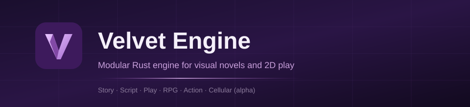

<p align="center">
  
</p>

<p align="center">
  <a href="https://www.rust-lang.org/"></a>
  <a href="LICENSE"></a>
  <a href="rust-toolchain.toml"></a>
  <a href="CHANGELOG.md"></a>
  <a href="docs/architecture/ROADMAP.md"></a>
  <a href="docs/architecture/CELLULAR.md"></a>
  <a href="docs/editor/STUDIO.md"></a>
</p>

<p align="center">
  <strong>Modular Rust game engine</strong> for visual novels, narrative adventures, 2D play and toon-shaded 3D worlds.<br/>
  Shared core · installable modules · dedicated languages: <strong>Velvet Script</strong>, <strong>Velvet Story</strong>, <strong>Velvet Style</strong>
</p>

<p align="center">
  <a href="#quick-start">Quick start</a> ·
  <a href="#highlights">Highlights</a> ·
  <a href="#try-it">Try it</a> ·
  <a href="#cli">CLI</a> ·
  <a href="#documentation">Docs</a> ·
  <a href="#workspace">Workspace</a> ·
  <a href="#license">License</a>
</p>

---

## Overview

Velvet Engine is built for experience families that share one core.
Combine freely: an RPG can embed branching dialogue; a novel can host a
minigame; action can cut to narrative — all styled with one UI language.

| Pillar | What you ship |
|--------|----------------|
| **Velvet Story** | Visual novels, branching dialogue, choices, rollback, saves, i18n |
| **Velvet Play / RPG / Action** | Top-down maps, collisions, stats, quests, combat loops |
| **Velvet Style** | CSS-like UI styling with cascade, `var()`, math, color functions and motion scripting |
| **Velvet 3D** | Toon-shaded 3D worlds: HDR, shadows, skinning, GPU crowds, water, navigation, AV1 video |
| **Velvet Cellular** *(alpha)* | Falling-sand / Noita-like materials for authors |

> **Status:** early development — see [`docs/architecture/ROADMAP.md`](docs/architecture/ROADMAP.md).<br/>
> **Cellular / sand** is **alpha** (`0.1.0-alpha.x`); APIs may break. Details: [`docs/architecture/CELLULAR.md`](docs/architecture/CELLULAR.md).<br/>
> **Velvet Studio** is **alpha** (same maturity band as cellular): usable for prototyping; APIs, UI, and file formats may break. Details: [`docs/editor/STUDIO.md`](docs/editor/STUDIO.md).

---

## Highlights

### Velvet Style — `.vcss` with real tooling

One language for look *and* motion: cascade with specificity, `:root`
custom properties, `calc()`/`min()`/`max()`/`clamp()`, gradients,
shadows, `@media` game conditions, `@keyframes`, and an embedded
JS-lite `@script` for orchestration.

```css
:root { --gold: #ebc878; --bg: #0a0c16; }

.card {
  color: color-mix(in srgb, var(--gold) 70%, #501e78);
  border: 2px solid var(--gold);
  background: auto-contrast(var(--bg));
  font: bold 16px/1.5 "Tahoma", sans-serif;
}
```

- `var()` works **inside** function arguments (`calc()`,
  `color-mix()`, `alpha()`, gradient stops, shadow colors) and folds at
  resolve time; anything undefined stays deferred and hosts skip it.
- Color pro: `oklch()`, `auto-contrast()` (WCAG pick) and `currentcolor`.
- CSS inheritance for text properties and every `--*` (`resolve_inherited`),
  plus `inherit` / `initial` / `unset`.
- Shorthands (`border:`, `background:`, `font:`) expand inline, honoring
  source order both ways.
- Author tooling, not guesswork:

```bash
velvet style check ui.vcss            # unknown props (did-you-mean), dead --vars, orphan keyframes…
velvet style explain ui.vcss .button.primary:hover color --ancestor .menu
velvet style dump ui.vcss --class button --state selected
velvet style snapshot ui.vcss --class button --write --expect themes/button.json
velvet style fmt ui.vcss [--minify]   # pretty or minified, both re-parse to the same AST
```

Full spec: [`docs/language/VELVET_STYLE.md`](docs/language/VELVET_STYLE.md).

### JS-lite motion scripting — `@script`

`let`/`fn`, `for`, `while`, `switch`/`case`/`default`, ternary, `??`,
backtick templates with `${…}` holes, arrays/objects, and 60+ built-ins
(`play`, `animate`, `wait`, `emit`, strings, collections, math, `rand`/`pick`,
`set`/`query`, `print`). Infinite loops are runtime errors, never hangs.

```
fn greet(name, hp) {
  let label = hp > 0 ? "hola " + (name ?? "anon") : "caido";
  switch (hp) {
    case 100: return label + " (full)";
    default: return label;
  }
}
```

### Velvet Story — novels that ship complete

Writer-friendly `.vel` / `.vstory` compiled to VS3 (`yield` + host):
screens + ATL transforms, `with` transitions, voice cast, music room,
gallery, save photos, branch map, rollback, history, accessibility and
`tl/en` + `tl/es` i18n out of the box. The `visual-novel` template is a
full Ren'Py-shaped starter: change names, images and dialogue only.

Docs: [`docs/language/VELVET_STORY.md`](docs/language/VELVET_STORY.md) ·
[2.5 notes](docs/language/VELVET_2_5.md) ·
[VS3 roadmap](docs/language/VS3_ROADMAP.md).

### Toon 3D, crowds and media

- **3D renderer** (`velvet-render`): toon shading with depth ink lines and grading, HDR + bloom,
  cached shadows, up to 32 point lights, GPU skinning, screen-space GI and AO, reflections, toon
  fire, living water, BC7 textures, FXAA / FSR 1 upscaling, native-resolution output.
- **GPU crowds** (`crowd3d`): thousands of animated soldiers of one model drawn as a single mesh,
  animated by a compute pass — the battles of Demon Queen run on it.
- **Media and packs**: AV1 pictures and clips decoded in pure Rust (`velvet-avif`), the VLZ
  random-access container (`velvet-vlz`, [format](docs/formats/VLZ_FORMAT.md)).
- **World**: navmeshes with ORCA crowds (`velvet-nav`), terrain and liquid synthesis, automatic QA
  walkers (`velvet-qa`).
- **Guiones** (`velvet-guion`): dialogue and visual-novel scenes written as Markdown.
- **Velvet Editor** *(alpha, `velvet-editor3d`)*: docked scene tree, inspector and scripts around
  the engine's own viewport.

### UI, animation and 3D building blocks

- **Retained UI** (`velvet-ui`): panels, buttons, sliders, toggles,
  dropdowns, tabs, tooltips, virtual lists, themes, nine-slice, gradients
  and shadows — driven by the same `.vcss` cascade, with timelines,
  springs, path tweens, FLIP and deterministic particles.
- **Interaction FX**: animated buttons, press ripples, repeat/double-click,
  busy states, focus-visible and UI sounds.
- **Scene3D** (`velvet-scene3d`): declarative `.scene3d.json` with
  validation, flattening, AABB/raycast physics, character controllers,
  animation clips with crossfade, deterministic particles and saves —
  exercised by a headless third-person sim.

---

## Quick start

**Requirements:** [Rust](https://www.rust-lang.org/) stable (see `rust-toolchain.toml`).

```bash
# Clone the engine and its supported demos
git clone https://github.com/dadtnttn/velvet-engine.git
cd velvet-engine

# CLI
cargo build -p velvet-cli --release
cargo run -p velvet-cli --release -- --help

# New project from a template (visual-novel, top-down-rpg, …)
cargo run -p velvet-cli --release -- new my-game --template visual-novel

# Play the bundled short novella, headless
cargo run -p velvet-cli --release -- play samples/short-novella --choice 0

# Check a stylesheet
cargo run -p velvet-cli --release -- style check templates/visual-novel/styles/ui.vcss
```

---

## Try it

| Path | Command | Notes |
|------|---------|--------|
| Hello Velvet | `cargo run -p hello-velvet --release` | Core plugins smoke |
| Short novella | `velvet play samples/short-novella --choice 0` | Product `VnSession` → named ending |
| Visual novel example | `cargo run -p visual-novel --release` | CLI story player |
| Branching story | `cargo run -p branching-story --release` | Multi-ending checks |
| Top-down RPG | `cargo run -p top-down-rpg --release` | Play + RPG loop |
| Action arena | `cargo run -p action-arena --release` | Combat sandbox |
| Cellular lab | `cargo run -p cellular-lab --release` | Headless author lab (**alpha**) |
| Studio GUI *(alpha)* | `cargo run -p velvet-editor --release -- gui templates/visual-novel --interactive` | Visual / Script / Nodes |

Supported demos: `cellular-arena`, `fx-forge`, `ui-gallery`, `terraflow`,
`third-person` and `rpg-quest-vs3`. Demon Queen, the game the engine grew up with, now
lives in its own private repository beside it and uses the engine's crates by path.
See [repository contents](docs/engineering/REPOSITORY_CONTENTS.md).

---

## CLI

`velvet --help` lists everything. The daily drivers:

| Area | Commands |
|------|----------|
| Projects | `new`, `init`, `launch`, `menu`, `project`, `template` |
| Story | `play`, `story`, `narrative`, `recheck-replay`, `localization` |
| Style | `style check/dump/run/eval/snapshot/fmt/explain` |
| Code | `script`, `vs3`, `app`, `fmt` (`.vel`), `document` |
| World | `scene3d`, `level`, `cards`, `assets`, `pack`, `export`, `image` |
| Meta | `doctor`, `version`, `check`, `test`, `build`, `clean`, `inspect` |

---

## Documentation

| Topic | Link |
|-------|------|
| Vision | [docs/architecture/VISION.md](docs/architecture/VISION.md) |
| Architecture | [docs/architecture/OVERVIEW.md](docs/architecture/OVERVIEW.md) |
| Docs index | [docs/README.md](docs/README.md) |
| Modules map (all crates) | [docs/architecture/MODULES.md](docs/architecture/MODULES.md) |
| File formats | [docs/formats/](docs/formats/) |
| Velvet JS plan (JavaScript framework) | [docs/architecture/JS_FRAMEWORK_PLAN.md](docs/architecture/JS_FRAMEWORK_PLAN.md) · [ADR 0009](docs/adr/0009-rust-and-js-runtimes.md) |
| Roadmap | [docs/architecture/ROADMAP.md](docs/architecture/ROADMAP.md) |
| Velvet Style (VCSS) | [docs/language/VELVET_STYLE.md](docs/language/VELVET_STYLE.md) |
| Velvet Script (JS-lite) | [docs/language/VELVET_SCRIPT.md](docs/language/VELVET_SCRIPT.md) · [v2](docs/language/VELVET_SCRIPT_2.md) · [v3](docs/language/VELVET_SCRIPT_3.md) |
| Velvet Story | [docs/language/VELVET_STORY.md](docs/language/VELVET_STORY.md) · [2.5](docs/language/VELVET_2_5.md) · [VS3 roadmap](docs/language/VS3_ROADMAP.md) |
| Demon Queen NPCs | [docs/engineering/DEMON_QUEEN_NPCS.md](docs/engineering/DEMON_QUEEN_NPCS.md) |
| Cellular (alpha) | [docs/architecture/CELLULAR.md](docs/architecture/CELLULAR.md) |
| Studio (alpha) | [docs/editor/STUDIO.md](docs/editor/STUDIO.md) |
| Tutorials | [docs/tutorials/](docs/tutorials/) |
| ADRs | [docs/adr/](docs/adr/) |
| Contributing | [CONTRIBUTING.md](CONTRIBUTING.md) |

Brand assets used on this page: [`docs/assets/`](docs/assets/).

---

## Workspace

```text
crates/      Engine libraries — 65 crates: core, render (2D + 3D), media, world, story, script, tools
examples/    Focused runnable examples (run from a fresh clone)
demos/       Supported engine demos
templates/   Project starters for `velvet new`
samples/     Ship-shaped sample projects (short-novella, vs3-logic)
docs/        Architecture, ADRs, formats, languages, tutorials (index: docs/README.md)
editors/     VS Code language support
tools/       Quality tooling
```

65 crates, one workspace, ~1950 tests behind a single gate:

```bash
cargo fmt --all -- --check
cargo check --workspace --all-targets --all-features
cargo test --workspace --all-targets --all-features
cargo clippy --workspace --all-targets --all-features -- -D warnings
python tools/check_repository.py
```

Cross-crate scenarios live in `crates/velvet-integration-tests/tests/`. See the [integration matrix](docs/architecture/INTEGRATION_MATRIX.md) for dependency direction and the proof attached to each subsystem.

---

## Design principles

- **Modular:** install only the crates you need.
- **Author-friendly:** narrative scripts, stylesheets and product play paths are first-class — with CLIs that explain themselves (`style explain`, `recheck-replay`).
- **Honest maturity:** alpha surfaces (**cellular**, **Studio**) are labeled; limitations documented.
- **Rust-native:** workspace crates, tests in-tree, dual license compatible with the ecosystem.

---

## License

Dual-licensed under **MIT OR Apache-2.0**, at your option.

- [LICENSE](LICENSE) — summary
- [LICENSE-MIT](LICENSE-MIT)
- [LICENSE-APACHE](LICENSE-APACHE)

Contributions are accepted under the same terms ([CONTRIBUTING.md](CONTRIBUTING.md)).

---

<p align="center">
  <br/>
  <sub>Velvet Engine 0.3.0 · early development</sub>
</p>
